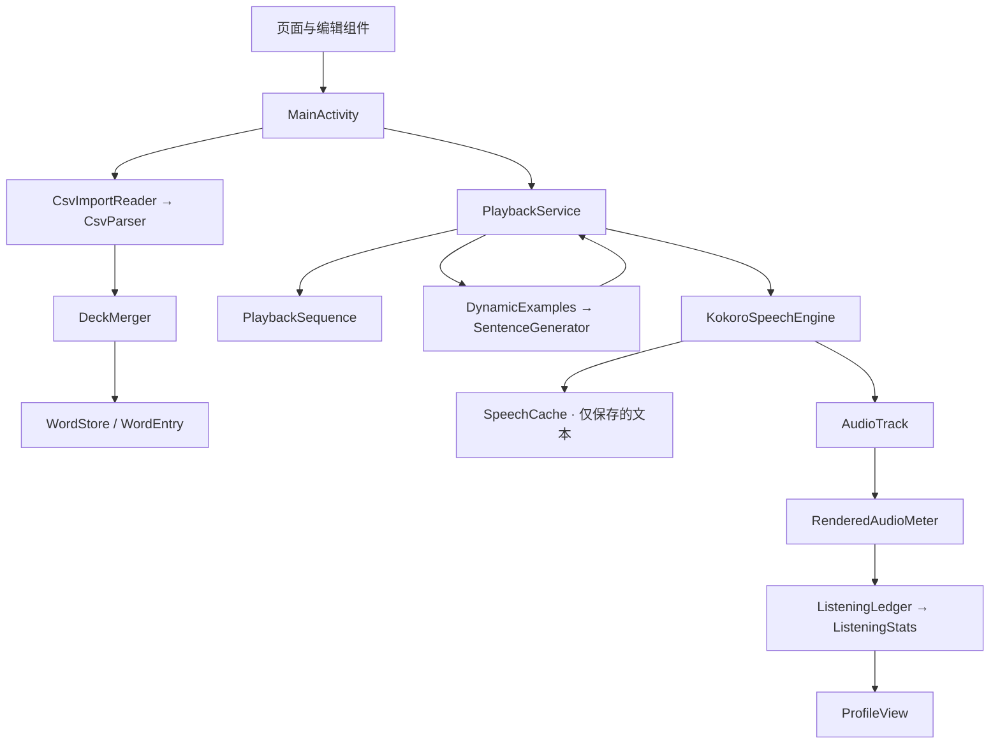

# 模块与维护约定

项目使用 Java 17 和 Android 原生组件，不引入框架。`cn.wordflow.app` 内按职责拆分类；纯 Java 业务逻辑可直接在 JVM 测试，Android I/O 和生命周期放在边界类。

| 模块 | 职责 |
| --- | --- |
| `WordEntry` | 不可变词汇、词频、导入例句与手动例句，提供播放片段 |
| `CsvParser` | 纯 Java CSV 语法解析；不访问文件、数据库或 UI |
| `CsvImportReader` | 系统文档 URI、限量读取和严格 UTF-8 解码 |
| `DeckMerger` | 纯 Java 稳定去重、累计词频、合并不同例句及词表上限 |
| `WordStore` | JSON 兼容迁移、不可变词表快照、AtomicFile 原子持久化 |
| `MainActivity` | 页面导航、导入与保存事务、服务绑定；不持有原生 TTS 模型 |
| `DeckListAdapter` / `EntryDialogs` / `ProfileView` / `UiWidgets` | 列表展示、例句编辑、个人设置与统计、共享控件样式 |
| `PlaybackSequence` | 纯 Java 词 / 片段 / 遍数游标与回调代次令牌 |
| `PlaybackService` | 前台播放生命周期、焦点、通知、唤醒锁和播放编排 |
| `KokoroSpeechEngine` / `SpeechChunks` / `KokoroCallback` | 单 worker 原生模型、分段、PCM 输出及 JNI 兼容回调 |
| `SpeechCache` | 有界磁盘 PCM 缓存，CRC 校验、临时提交和 LRU 淘汰 |
| `RenderedAudioMeter` / `ListeningLedger` / `ListeningStats` | 已播帧增量、按本地日期切分、持久化每日统计 |
| `AiSettings` / `SentenceGenerator` | KeyStore 配置与固定官方 HTTPS 请求 / 响应协议 |
| `NetworkStatus` / `DynamicExamples` | 网络可用性、单次限时请求、取消和临时结果回调 |

## 数据和兼容性

- 旧 `decks.json` 的 `word` / `sentence` / 可选 `customExamples` 继续读取。新增 `frequency` 默认 1，`importedExamples` 缺失时从原 `sentence` 迁移；写入时保留主 `sentence` 字段。
- `WordEntry` 的例句列表和 `Deck.entries` 不可修改。编辑、合并创建新快照，写盘成功后才替换界面及服务快照。整批导入任一文件失败不提交。
- 空例句不进入播放片段，但词汇仍保留。词频是导入计数，与用户选择的播放遍数分离。稳定合并使用 `Locale.ROOT` 忽略大小写；相同例句按完整文本去重。
- 大模型 Key 只在 `AiSettings` 加解密，Header 携带，不进入请求 JSON、词表或日志。统计使用独立 SharedPreferences，不随语音缓存清理。

## 播放与异步约定

- 播放状态和监听回调在主线程；TTS 原生模型仅在单 worker 使用。全局模型信号量防止服务重建时两个大模型同时占用内存。
- 每片段用 `PlaybackSequence` 代次令牌拒绝过期回调。暂停 / 切词 / 切表 / 调速取消 TTS、待播延迟和动态请求；重设选词清零遍数。
- 每遍保存片段播完最多请求一条动态例句。临时例句使用额外的终止片段，完成后只推进遍数 / 词，不会再触发 AI。无已存例句的词，在读完词后走同样路径。
- 临时结果只在服务会话内存中使用，并通过 `speakTransient` 绕过 SpeechCache 读取和写入。预缓存只枚举 `WordEntry.fragments()`，不会调用 AI。
- 动态生成先检查连接验证、开关和 Key；20 秒预算、单请求、不重试、不收费回退。取消及超时后旧网络结果不再交付。
- 收听时长只采集 AudioTrack 播出头的增量；每段单独计数，暂停 / 结束前结算。没有帧移动就没有时长；按秒附近采样、按帧折算累积，避免逐次取整损失。日期拆分使用手机当前时区，支持夏令时。
- `KokoroCallback.invoke(float[]) → Integer` 是 sherpa JNI 所需的真实方法签名，不能直接换成泛型 Java lambda。签名已有回归测试和历史 Linux 原生 smoke 验证。

## 维护流程

1. 业务变动优先落在对应纯 Java 模块；Android 类只负责 I/O 或编排。
2. `bash scripts/format-java.sh` 统一格式，版本和下载校验固定。
3. `./gradlew testDebugUnitTest lintDebug assembleDebug`；CSV 也可 `bash scripts/check-csv.sh` 独立检查。
4. 合并、兼容迁移、重复游标、已播帧计数和跨日拆分都有单元测试。真实 AudioTrack、KeyStore、系统文件选择器、后台限制与模型账户需真机验收，不能用 JVM 测试代替。
5. 改动模型、声音、缓存格式等影响音频含义时更新缓存键版本；仅修改页面、合并或统计时沿用现有模型和缓存键以保留缓存。
